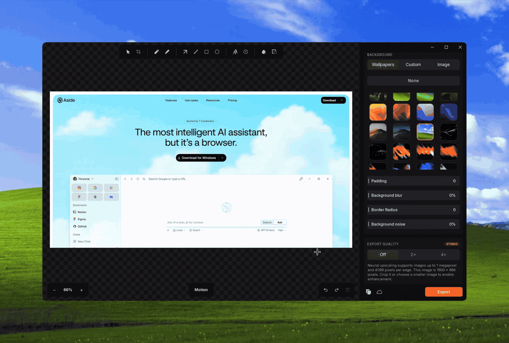

# ApexShot

Screenshots, screen recordings, and polished edits for Windows and Linux.
Capture a region, a window, or a whole scrolling page; mark it up; pull out its
text; record your screen with your camera; and turn the result into a clean,
shareable image or video.



[**Download for Windows**](https://github.com/apex-shot/apexshot/releases/latest) ·
[**Install on Linux**](#linux) ·
[Website](https://apexshot.org/) ·
[Releases](https://github.com/apex-shot/apexshot/releases) ·
[Report a bug](https://github.com/apex-shot/apexshot/issues/new/choose)


## Install

### Windows

Windows 10 or 11, 64-bit. No administrator rights needed.

1. Download `ApexShot-<version>-setup.exe` from the
   [latest release](https://github.com/apex-shot/apexshot/releases/latest).
2. Run it. ApexShot installs for your user, adds a Start menu entry, and walks
   you through setup. It then lives in the system tray.

The installer is not code-signed yet, so SmartScreen may warn you the first
time: choose **More info → Run anyway**.

### Linux

One command detects Ubuntu/Debian, Arch Linux, or Fedora and installs the
matching package:

```bash
curl -fsSL https://apexshot.org/install | sh
```

Update later with `apexshot update`. Known-good desktops are Ubuntu GNOME
Wayland, Arch Linux GNOME Wayland, Hyprland Wayland, and Fedora KDE Plasma
Wayland (screenshots). Video recording is not supported on Fedora.

Per-distro installs, NixOS, the GNOME Shell extension, building from source, and
the full desktop support table are in the [install guide](docs/INSTALL.md).

## Features

### Capture

- **Screenshots** — full screen, area, window, and scrolling capture of long
  pages and windows
- **Screen recording** — screen, area, or window, with microphone and system
  audio, a countdown, and on-screen pause and stop controls
- **Camera** — a webcam bubble you can place and style in the recording
- **Text and QR codes** — copy the text out of any capture with OCR, and
  detect QR codes automatically

### Edit

- **Image editor** — arrows, shapes, text, numbered steps, highlighter, blur,
  pixelate, crop, and a color picker; backgrounds, padding, rounded corners,
  shadows, and frame styles; reopen an exported image with its annotations
  still editable
- **Motion** — turn a still screenshot into a short animated video with camera
  moves, titles, and motion blur
- **Video editor** — trim and cut, speed changes, automatic and manual zooms,
  cursor smoothing and click effects, backgrounds, camera layouts, and exports
  in MP4 (H.264 or HEVC) with hardware encoding where available
- **Autosave** — editor sessions are saved as you work, so a crash or a closed
  window doesn't lose your edit

### Share and organise

- **History** — screenshots, recordings, Motion edits, video edits, and cloud
  uploads in one window
- **Cloud** — upload to ApexShot Cloud for a share link, or to a self-hosted
  XBackBone server
- **Clipboard and Quick Access** — every capture lands on the clipboard and in
  a quick-access card for drag-and-drop
- **Shortcuts and tray** — global hotkeys for every capture and recording
  action, from a system tray app that starts with your computer

Not every feature is on both platforms yet; the
[platform notes](docs/INSTALL.md#supported-desktops) list what each Linux
desktop supports.

## ApexShot Studio

ApexShot is free and open source. Capture, annotation, OCR, recording, and the
editors' core tools stay free, with no account or watermark required.
**Studio** adds the advanced styles and exports, such as frame styles and Motion
video export, through a licence from the
[pricing page](https://apexshot.org/pricing). You can also support development
on [Ko-fi](https://ko-fi.com/codegoddy).

## Status

ApexShot is in **public beta**. The Windows build is new; please
[open an issue](https://github.com/apex-shot/apexshot/issues/new/choose) if
something breaks. The issue templates ask for your platform, desktop, and
version so we can reproduce it quickly.

## Documentation

- [Install guide](docs/INSTALL.md) — every platform and distro, updating,
  building from source, and the Linux CLI
- [Contributing](CONTRIBUTING.md) — development setup, code layout, and style
- [Developer docs](docs/README.md) — architecture, modules, and release
  operations
- [Security policy](SECURITY.md)

## Tech stack

| Layer | Technology |
|---|---|
| Core | Rust |
| Interface | GTK 4 on both platforms |
| Capture shell | C++17 / Qt 5 (region selection, capture and recording controls) |
| Windows capture | Desktop Duplication, Windows Graphics Capture, FFmpeg encoding |
| Linux capture | XDG portals and PipeWire, `wlr-screencopy` on wlroots, X11 fallback |
| Text recognition | Windows OCR on Windows; Tesseract and ocrs on Linux |

## License

GPL-3.0-or-later. See [LICENSE](LICENSE).
